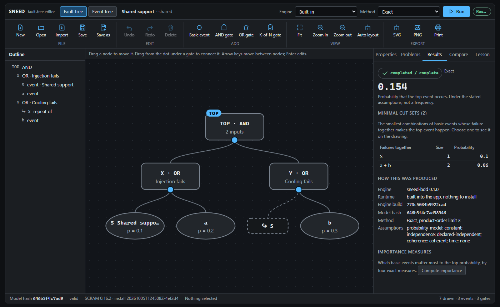
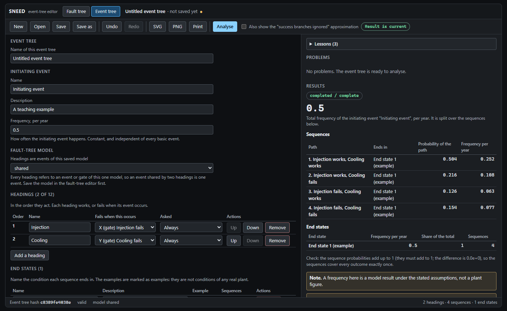
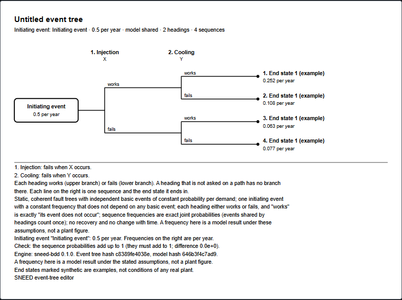

# SNEED

SNEED (Safety in Nuclear Engineering Educational Design, formerly PRA & Reliability Studio) is a teaching tool for fault trees and event trees. A student draws a tree in a browser, sees its minimal cut sets and the probability it works out to, checks the answer against a hand calculation, and works through short lessons. It is meant for a classroom or self-study, and for a teacher who wants worked cases whose answers are known.

**Status: experimental and educational. Results are not validated for safety, licensing or operation, and are not plant risk figures.** All probabilities and frequencies in the examples and lessons are invented and labelled as such.







*The numbers in these pictures are invented examples. They are made by `npm run screenshots`.*

## What it does

- **Fault-tree editor** (browser): draw events and AND, OR and voting gates, set probabilities, group events that can fail together (beta-factor common-cause groups), validate, analyse, compare two saved analyses, undo and redo, print or save the drawing as SVG or PNG.
- **Exact analysis.** A built-in solver (a binary decision diagram, with a source-hash identity recorded in every result) gives the exact top-event probability, minimal cut sets, importance measures and, where asked, bounds. It is checked against independent hand-derived and enumeration oracles. The optional SCRAM engine can be run beside it as a cross-check.
- **Event trees.** One initiating event with a frequency per year, up to 12 yes/no headings that are events or gates of one fault-tree model, sequences with example end states, exact sequence frequencies (an event shared by two headings counts once), a drawing, saved analyses and a comparison of two of them.
- **Lessons.** Five fault-tree lessons and three event-tree lessons, each graded against a hand-worked answer. Instructor sheets with discussion questions and model answers are in [docs/LESSON-REVIEW.md](docs/LESSON-REVIEW.md) and [docs/EVENT-TREE-LESSON-REVIEW.md](docs/EVENT-TREE-LESSON-REVIEW.md).
- **Open-PSA subset.** Import and export of a documented subset of the Open-PSA model exchange format ([docs/OPEN-PSA-SUBSET.md](docs/OPEN-PSA-SUBSET.md)).
- **Headless runner.** Command-line verbs to describe, validate, run and cancel an analysis for fault trees and event trees, with typed errors and a machine-readable result ([docs/HEADLESS.md](docs/HEADLESS.md)). It is the interface used by the SEED experiment harness.
- **Thermal-hydraulic link, early.** Records and server routes for a success criterion on one event-tree heading, an answer entered by hand from a thermal-hydraulic run, and a record of plant-model edits; a judgement says whether the answer held, did not hold, is stale or is not determined. It is a fact about one run, never a probability. There is no screen for it yet, and SNEED reads no plant model ([docs/plans/14-th-link.md](docs/plans/14-th-link.md)).

## Try it

Needs Node.js 24 and npm. Tested on Windows 11 only.

```
npm install
npm start
```

Then open <http://127.0.0.1:5205>. The built-in solver needs nothing else. Models and saved analyses are kept in a `.sneed` folder in your home folder (set `SNEED_PROJECT_DIR` and `SNEED_RUNS_DIR` to change that); the server listens on the local machine only.

To also use the SCRAM cross-check (optional, Windows with WSL): `npm run runtime -- install` builds it from a recipe in `runtime/`; see [docs/RUNTIME.md](docs/RUNTIME.md). Without it, choosing SCRAM says so in words and everything else works.

How the editor is built, run and tested, and what is still open: [docs/EDITOR.md](docs/EDITOR.md).

## Tests

```
npm run typecheck
npm test              # unit tests, no extra software needed
npm run e2e           # browser tests (Playwright)
npm run test:engine   # also needs WSL and an installed SCRAM
```

[TODO.md](TODO.md) is the current status and what is open. The method (oracles, mutation checks of the tests) is in [docs/WORKFLOWS.md](docs/WORKFLOWS.md).

## How it was made

AI tools wrote much of the code, tests and documents in this repository: Claude (Anthropic) wrote and checked most of it, and other AI tools did some delegated tasks and reviews. A person set the goals, made the decisions listed in [TODO.md](TODO.md) and owns the repository. The results do not rest on trust in the AI: they are checked against hand-derived and brute-force oracles ([docs/WORKFLOWS.md](docs/WORKFLOWS.md)).

## Contributing and security

See [CONTRIBUTING.md](CONTRIBUTING.md) to help, and [SECURITY.md](SECURITY.md) to report a problem. A GitHub Actions workflow ([.github/workflows/ci.yml](.github/workflows/ci.yml)) runs the typecheck, the unit tests and the web build on Node 24.

## Licence and third-party software

SNEED is MIT licensed ([LICENSE](LICENSE)). Packages it uses are listed in [THIRD_PARTY_NOTICES.md](THIRD_PARTY_NOTICES.md).

**SCRAM** (an open-source fault-tree engine, GPL-3.0) is optional, is built separately on your machine from its own source, and is never bundled with or distributed by this repository. SNEED runs it as a separate program and reads its XML report.

## Limits that matter

- **Model class.** Static, coherent fault trees with independent basic events of constant probability per demand. Common-cause groups (beta-factor, an invented parameter) can be drawn and edited in the editor and are analysed by the built-in engine and the SCRAM engine, which cannot yet be checked here against the real SCRAM (see [TODO.md](TODO.md)). Event trees and importance measures do not handle them yet ([plan 15](docs/plans/15-common-cause.md)). No time dependence, no uncertainty analysis. Event trees have one initiating event with a constant frequency, yes/no headings and no recovery actions.
- **Numbers.** Probabilities and frequencies are inputs, not data. Example end states are named "(example)". A frequency here is a result under these assumptions, not a plant figure.
- **Teaching material.** The lessons have not yet had an instructor's read, and the interface has not yet had a human screen-reader pass; both are open ([docs/SCREEN-READER-PASS.md](docs/SCREEN-READER-PASS.md)).
- **Thermal-hydraulic link.** Early, with the answer entered by hand; what the caller says about plant models and the solver is taken as stated.
- **Not a safety tool.** Do not use it to make a licensing, design or operating decision.

## Where things are

`src/core/` the validator, hashing and analysis rules; `src/engines/` the solvers; `src/server/` and `src/web/` the app; `src/cli/` the headless runner; `schema/` the JSON Schemas and fixtures; `lessons/` the lessons; `tests/` the oracles and tests; `docs/` design notes, starting at [docs/README.md](docs/README.md); [PLAN.md](PLAN.md) is the overall plan.
